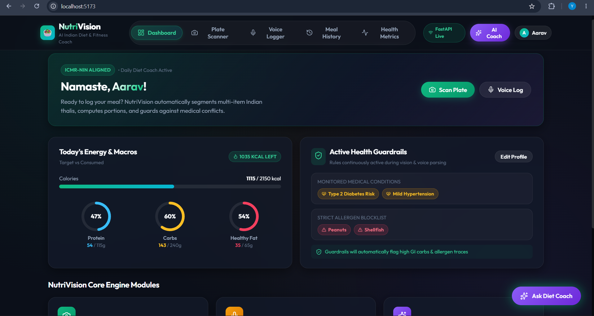
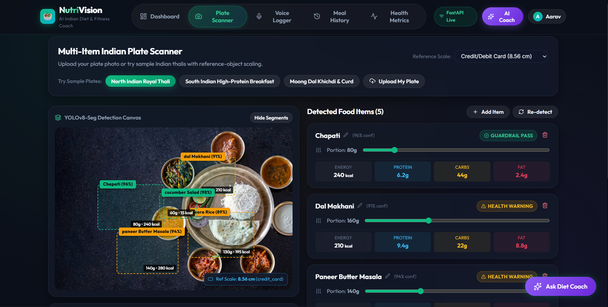
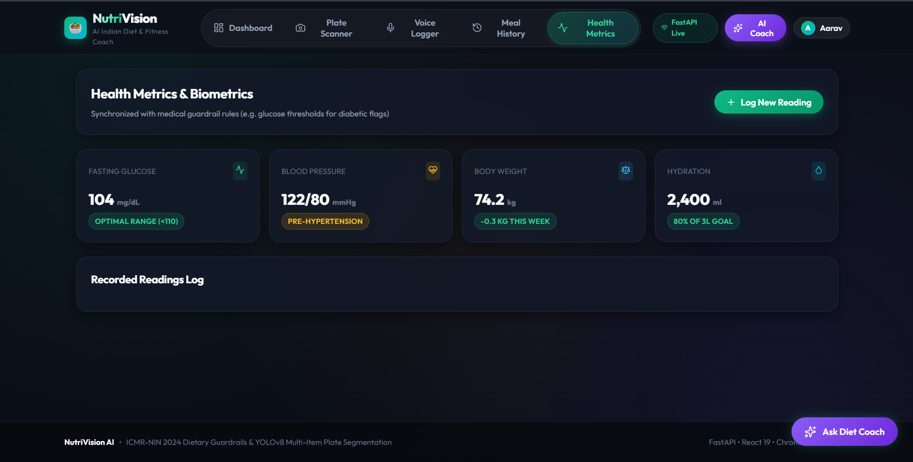

# NutriVision 🥗

AI-driven nutrition assistant for multi-item Indian meals — with food detection, calorie tracking, voice logging, RAG-powered diet coaching, and health guardrails.

---

## 🏗️ Architecture

| Layer | Technology |
|---|---|
| Frontend | React 19 + Vite + Lucide Icons |
| Backend | FastAPI (Python) |
| Vision | YOLO26n-Seg; classification refinement is a future option |
| Portion Estimation | Reference-object scaling + food density |
| Nutrition DB | Curated reference database |
| Guardrails | Allergen / health rule engine |
| RAG / Chat | ChromaDB + Anthropic Claude |
| Speech | Whisper + meal parser |
| Database | SQLite by default; PostgreSQL optional |

---

## 🚀 How to Run

### Prerequisites

- **Node.js** ≥ 18 and **npm** ≥ 9
- **Python** ≥ 3.10
- **Git**

---

### 🖥️ Frontend (React + Vite)

The frontend runs on **http://localhost:5173** and proxies all `/api` requests to the backend at `http://localhost:8000`.

```bash
# 1. Navigate to the frontend folder
cd frontend

# 2. Install dependencies
npm install

# 3. Start the development server
npm run dev
```

#### Available Scripts

| Command | Description |
|---|---|
| `npm run dev` | Start local dev server at http://localhost:5173 |
| `npm run build` | Build production bundle to `dist/` |
| `npm run preview` | Preview the production build locally |
| `npm run lint` | Run oxlint for code quality checks |

---

### ⚙️ Backend (FastAPI)

The backend runs on **http://localhost:8000**.  
Interactive API docs are available at **http://localhost:8000/docs**.

```bash
# 1. Navigate to the backend folder
cd backend

# 2. Create a virtual environment
python -m venv .venv

# 3. Activate the virtual environment
# Windows (PowerShell):
.venv\Scripts\activate
# Windows (CMD):
.venv\Scripts\activate.bat
# Linux / macOS:
source .venv/bin/activate

# 4. Install dependencies
pip install -r requirements.txt

# 5. Set up environment variables
cp .env.example .env
# Then open .env and fill in your API keys (see Environment Variables below)

# 6. Start the development server
uvicorn app.main:app --reload
```

#### Environment Variables (`.env`)

| Variable | Description |
|---|---|
| `DATABASE_URL` | DB connection string (default: `sqlite:///./nutrivision.db`) |
| `JWT_SECRET_KEY` | Secret key for JWT auth — **change in production** |
| `YOLO_CHECKPOINT_PATH` | Local path to a YOLO26 segmentation checkpoint; use a fine-tuned food `best.pt` in production |
| `YOLO_CONFIDENCE` | Minimum detection confidence (default: `0.25`) |
| `YOLO_IMAGE_SIZE` | YOLO inference image size (default: `640`) |
| `YOLO_DEVICE` | Optional Ultralytics device, e.g. `cpu`, `0`, or `cuda:0` |
| `WHISPER_MODEL` | Whisper model size e.g. `base`, `small` (optional) |
| `ANTHROPIC_API_KEY` | Anthropic API key for RAG/chat features |
| `NUTRIVISION_LLM_MODEL` | LLM model name (default: `claude-sonnet-4-5`) |

> Photos are processed locally by a mask-capable YOLO26 model. `yolo26n.pt` is detection-only and is rejected because portion estimation needs masks. The official `yolo26n-seg.pt` knows COCO classes only; fine-tune it on annotated Indian-food polygons before using the result for nutrition. Set `USE_MOCK_DETECTOR=true` only for explicit demo mode.

### Vision setup and validation

The repository does not include model weights. Fine-tune `yolo26n-seg.pt`, copy the resulting food checkpoint outside Git (for example `checkpoints/best.pt`), and configure its local path before starting the backend. The app loads only that local file, so it does not download large weights at startup.

```powershell
cd backend
pip install -r requirements.txt
$env:YOLO_CHECKPOINT_PATH = "$PWD\..\checkpoints\best.pt"
$env:YOLO_CONFIDENCE = "0.25"
python -m pytest
uvicorn app.main:app --reload
```

The photo API requires a known reference measurement in the image to estimate portions. Nutrition values are estimates; benchmark them against manually weighed plates before relying on them.

---

### Images




### 🔄 Running Both Together

Open **two terminals** side by side:

**Terminal 1 — Backend:**
```bash
cd backend
.venv\Scripts\activate   # Windows
uvicorn app.main:app --reload
```

**Terminal 2 — Frontend:**
```bash
cd frontend
npm run dev
```

Then open **http://localhost:5173** in your browser. The frontend will automatically proxy API calls to the backend.

---

## 📁 Project Structure

```
MP3_NutriVision/
├── frontend/          # React + Vite app
│   ├── src/
│   │   ├── components/   # UI components (dashboard, voice-logger, guardrails…)
│   │   ├── api/          # API client & mock data
│   │   └── context/      # Global app state (AppContext)
│   ├── index.html
│   └── vite.config.js    # Dev server + proxy config
├── backend/           # FastAPI app
│   ├── app/           # Routes, models, services
│   ├── requirements.txt
│   └── .env.example
├── API_SPEC.md
├── ARCHITECTURE.md
├── DATA_MODEL.md
├── ML_PIPELINE.md
├── ROADMAP.md
└── SETUP.md
```

---

> This repository is a production-oriented scaffold. ML checkpoints and curated medical knowledge are intentionally not bundled.
